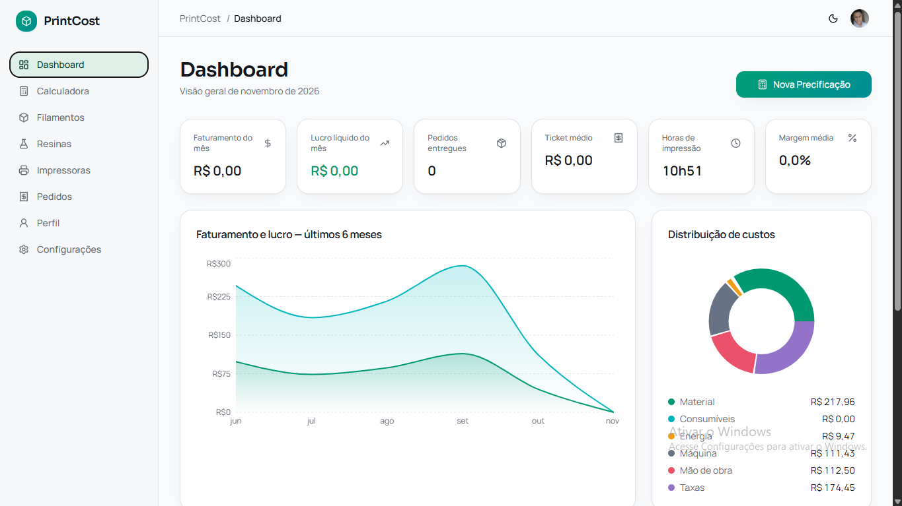
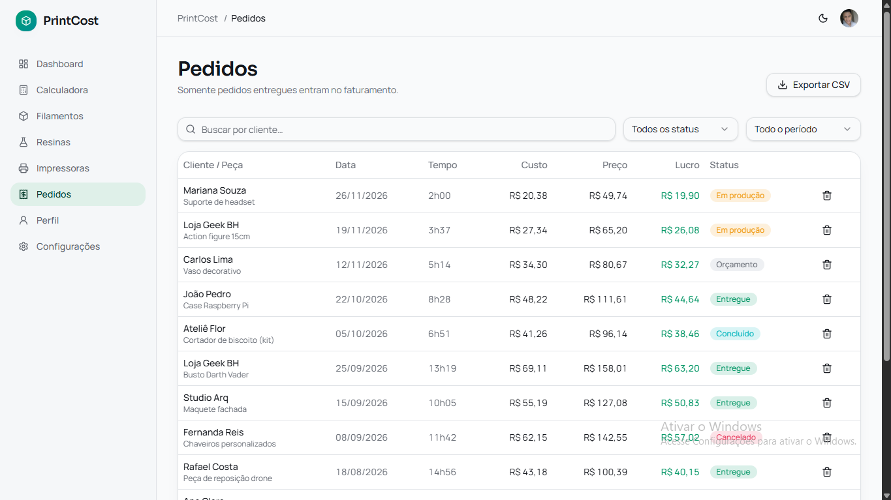
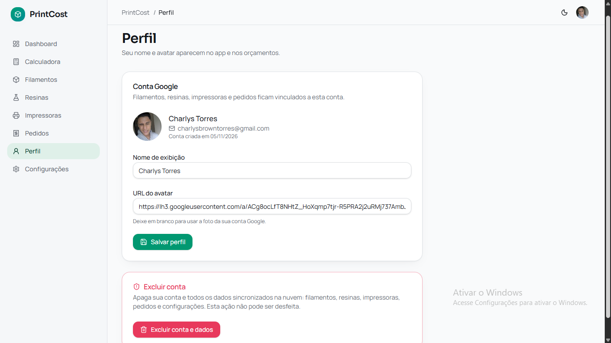

# PrintCost - Calculadora de Precificação 3D

PrintCost é uma aplicação completa para cálculo de custos e precificação de impressões 3D em filamento (FDM) e resina (SLA/DLP). Acompanhe seu faturamento, lucro, estoque de materiais e gestão de pedidos.

## Telas da Aplicação

A aplicação inclui as seguintes telas:

- **Dashboard** - Visão geral de faturamento, lucro e indicadores dos seus pedidos
- **Calculadora** - Precifique impressões em filamento e resina com cálculos detalhados
- **Filamentos** - Controle o estoque de filamentos por material, marca e fornecedor
- **Resinas** - Gerencie seu estoque de resinas em ml com custo por litro
- **Pedidos** - Acompanhe pedidos, altere status e exporte CSV
- **Perfil** - Gerencie nome, avatar e configurações da conta
- **Configurações** - Valores padrão de energia, mão de obra, resina, taxas e margem

## Telas da Aplicação (prints)








## Tecnologias

- **TanStack Router** - Roteamento client-side tipado (SPA, sem SSR)
- **TypeScript** - Tipagem estática completa
- **React** - Interface interativa
- **Tailwind CSS** - Estilização utilitária
- **Supabase** - Backend e autenticação Google
- **Vite** - Build tool e dev server
- **PWA (vite-plugin-pwa)** - Instalável e funcional offline via service worker

## Desenvolvimento

Preferindo trabalhar localmente? Você precisa de Node.js e npm — [instale com nvm](https://github.com/nvm-sh/nvm#installing-and-updating).

```sh
git clone <this-repository-url>
cd <repository-name>
npm i
npm run dev
```

## Como executar

```sh
# Instalar dependências
npm i

# Executar modo desenvolvimento
npm run dev

# Build para produção
npm run build

# Preview do build
npm run preview
```

## Autenticação

Para usar o login Google, configure o Supabase:

1. Defina as chaves no arquivo `.env`:
   - `VITE_SUPABASE_URL=https://SEU-PROJETO.supabase.co`
   - `VITE_SUPABASE_ANON_KEY=sua-chave-anon-publica`
2. No Supabase, vá em Authentication → Providers e ative o Google
3. Adicione URLs de Redirect: `http://localhost:5173/login` e seu domínio
4. Rode o schema.sql no SQL Editor do Supabase
5. Reinicie o servidor de desenvolvimento

## Firebase Hosting

Esta aplicação está configurada para ser implantada no Firebase Hosting. Consulte a seção de GitHub Actions abaixo para automação de deploy.

## Licença

Este projeto está licenciado sob os termos da MIT.
